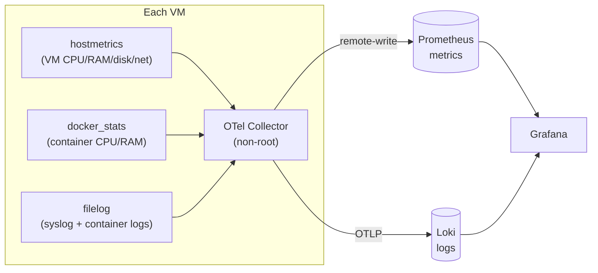

# Architecture & Internals (deep dive)

This document explains **exactly** how the Kubernetes AIOps agent works today: the
request flow, what every file does, why there are two endpoints, what it can and
cannot do, and why it is fintech-grade and air-gapped. Plain language, accurate,
no hand-waving.

---

## 1. One-line summary

A user asks a plain-English question → a **local** LLM (Ollama, Qwen 7B Q5) decides
which **read-only** Kubernetes lookup to run → the code checks it against strict
rules → runs `kubectl` (read-only) → the LLM explains the result in plain English.
**The model only suggests. The code decides. Nothing can ever be changed.**

---

## 2. The journey of one question (end to end)

```
  You (bastion)                 AI server (ai-dev 192.168.255.30)                 Cluster
  ───────────────   HTTP:443   ──────────────────────────────────   kube 6443   ──────────
  ask / curl  ──────────────▶  FastAPI (main.py)
                               │  1. auth.py        check the token (fail-closed)
                               │  2. schemas.py     validate the question
                               │  3. llm.py ───────▶ Ollama (local, no internet)
                               │                     "which read-only tool?"
                               │  4. policy.py      is it allowed + safe? (WALL 1)
                               │  5. tools.py       build the kubectl arguments
                               │  6. executor.py    run read-only kubectl (WALL 2) ──▶ proxy ──▶ cluster
                               │  7. counts.py      compute EXACT numbers in code
                               │  8. redact.py      mask any secret-looking text
                               │  9. llm.py ───────▶ Ollama: write the plain answer
                               │ 10. audit.py       log every step (who/what/result)
  plain answer ◀──────────────┘
```

The cluster itself enforces **WALL 3** (read-only RBAC) no matter what reaches it.

---

## 3. The two endpoints — why there are two

| | `POST /query` | `POST /investigate` |
|---|---|---|
| **For** | quick facts | "why is X broken?" |
| **How** | 1 question → 1 read-only kubectl → answer | a **loop**: pick a tool, read result, pick the next, up to a few steps, then explain |
| **Speed** | fast (one model call) | slow (several model calls; ~1–3 min on CPU) |
| **Example** | "how many pods are running" | "why is the web pod restarting in prd" |
| **Returns** | the kubectl output (+ exact count) | plain-English answer + the evidence steps |

The **`ask` client** on the bastion picks the endpoint automatically: words like
*why / logs / crash / failed / debug / investigate* → `/investigate`; everything
else → `/query`. The user just types a question.

### Inside `/investigate` — the think → act → observe loop
```
  repeat (max_steps, bounded by a time budget):
     model: "next read-only tool?"  ── or "final" to stop
        → policy check (WALL 1)  → build args (tools.py)  → run (executor, WALL 2)
        → compute exact counts (counts.py)  → redact secrets (redact.py)
        → feed the result back to the model as evidence
  then: model writes the final plain-English answer (grounded only in what it saw)
```
Guards that keep the weak model sane: **de-duplicate** repeated calls, **skip
redundant** re-listing after `list_all_pods`, **reserve time** for the final
answer, **cap** output size and total time, and fall back to an honest message if
it gathers nothing.

**Optional RAG memory** (`app/memory.py`, off by default): before planning, the loop
recalls the **tool names** that worked for similar past questions and adds them as a
hint; after a good answer it remembers the question + tools used. It stores **tool
names only** (never data), re-injects **no free-text** (no injection surface), is
**allowlist-gated** and **fail-open**, and the three walls still gate every tool — so
it improves consistency without ever going stale or escalating privilege. See
[docs/10-rag.md](docs/10-rag.md).

---

## 4. Every file and its job

### `app/` — the agent (runs in the container on the AI server)

| File | Responsibility (single job) |
|------|------------------------------|
| `main.py` | The FastAPI app. Wires everything, exposes `/healthz`, `/query`, `/investigate`. Holds the rate-limiter, the concurrency cap, the short-TTL cache, and the friendly-error handler. |
| `auth.py` | Checks the `Authorization: Bearer` token. **Fail-closed** (no/invalid token = rejected), constant-time compare (no timing leak). |
| `schemas.py` | Pydantic models for every request/response/action/tool-call. Rejects malformed or oversized input before it reaches logic. |
| `llm.py` | The only file that talks to Ollama. `interpret()` (for `/query`), `next_step()` + `synthesize()` (for the loop). Turns model text into validated structures; any bad model output becomes a clean error, never a crash. |
| `policy.py` | **WALL 1 — the safety core.** The allowlist (which read-only verbs/tools are permitted), argument sanitising (blocks injection and flag-injection), and optional namespace scoping. |
| `tools.py` | The read-only tool catalog. Each tool builds a fixed, read-only `kubectl` argument list. **No tool can create/change/delete — those simply do not exist.** |
| `executor.py` | **WALL 2.** Runs `kubectl` as an argument array (no shell = no injection). Hard-refuses any non-read-only verb. Caps output size and bounds log reads so a huge result can't exhaust memory. |
| `counts.py` | Computes **exact** numbers (row counts, status tallies) from kubectl output **in code**, because small LLMs miscount. The model is told to use these numbers verbatim. |
| `redact.py` | Masks secret-looking strings (passwords, tokens, JWTs, keys, DB URLs) in all output, on both endpoints and the final answer. Defence in depth behind RBAC. ReDoS-safe (linear time). |
| `agent_loop.py` | The `/investigate` controller: the think→act→observe loop, all the guards (dedupe, redundancy, time budgets, fallbacks). |
| `audit.py` | Writes one JSON line per event to stdout (who asked, what ran, the result) for the SIEM / forensic trail. |
| `config.yaml` | All tunables: Ollama URL/model/timeouts, default namespace, the allowlist, the tool list, loop limits, cache TTL. |
| `OLLAMA_BRAIN.md` | The strict system prompt for the model: English-only, read-only, never act, never invent, treat tool output as untrusted, worked examples. |

### `client/` — the bastion front end
| File | Job |
|------|-----|
| `ask.py` | A simple prompt box. Reads the token from a `600` file, auto-routes to `/query` or `/investigate`, prints **plain text only** (no JSON). Friendly errors, no tracebacks. |

### `k8s/` and `infra/` — cluster & network
| File | Job |
|------|-----|
| `k8s/kind-config.yaml` | The 3-node test cluster definition (pinned version). |
| `k8s/rbac/*.yaml` | **WALL 3.** The read-only ServiceAccount/User + ClusterRole + binding: get/list/watch only, **never secrets, never configmaps, no writes**. |
| `infra/nginx/stream.d/kube-api.conf` | The L4 reverse proxy to the cluster API (TCP passthrough; TLS stays intact). |

### `tests/` — the safety net
Full unit + integration + security tests (policy, tools, executor, counts, redact,
auth, loop, cache, routing, end-to-end API, attack cases). All green.

---

## 5. The three walls (why a breach stays small)

```
  Question ─▶ [WALL 1: policy.py allowlist] ─▶ [WALL 2: executor read-only verbs] ─▶ [WALL 3: cluster RBAC]
```
- **WALL 1** stops bad requests *through* the agent (fast, specific, catches prompt-injection too).
- **WALL 2** is the executor refusing any non-read-only verb, even if WALL 1 were edited wrong.
- **WALL 3** stops anything that goes *around* the agent (leaked kubeconfig, manual kubectl, container breakout) — the cluster itself only grants read.

Each wall is independent. All three must fail for a write to happen — and no
write-capable tool exists anywhere in the first place.

---

## 6. What it CAN do (capabilities)

- Answer read-only questions about the cluster in plain English.
- Exact counts and status ("14 pods, all Running") — computed in code, always correct.
- Investigate "why is X broken": status → events → logs → a likely cause + a
  suggested fix **for a human**.
- Refuse cleanly: off-topic chat, action requests, secrets — all denied.
- English-only answers regardless of the question's language.
- Full audit trail of every tool it ran.

## 7. What it CANNOT / should NOT do (limitations)

- **Cannot change anything** — no create/apply/scale/restart/delete. By design.
- **Cannot read secrets or configmaps** — blocked by RBAC.
- **Not a chatbot** — scoped to the cluster only (on purpose, for safety).
- **Not real-time** — a CPU 7B takes seconds to minutes; it is an *explainer*, not a detector. (Real-time detection is Prometheus's job, not the LLM's.)
- **Not a source of truth for math** — numbers come from code, not the model.
- **Weak-model limits** — a 7B can phrase clumsily or occasionally pick an extra
  step; the guards and deterministic counts contain this, but sharp/fast answers
  need a bigger model + GPU.
- **Advisory only** — it suggests fixes; a human applies them.

---

## 8. "Fintech-grade" in plain words

It is built so that even in the worst case, the damage is tiny and everything is
provable:

- **Least privilege** — it can only *read*, and only the specific things on the
  allowlist. It cannot touch secrets.
- **Defence in depth** — three independent walls, not one. One failure ≠ a breach.
- **Low blast radius** — each machine can reach only its one neighbour, so a
  compromised box can't roam.
- **Fail-closed** — missing token, missing config, bad input → it refuses, never
  guesses.
- **Full audit** — every question and action is logged as JSON for the SIEM, so
  there is a complete, timestamped record (non-repudiation).
- **No data leaves** — fully offline (see air-gap below), so cluster data is never
  exposed to any third party.

## 9. "Air-gapped" in plain words

Air-gapped means **no path to the internet**. Specifically:

- The **Ollama model runs locally** on the AI server; it was downloaded once and
  then the internet was cut. It never calls out.
- The **Ollama container sits on an internal-only Docker network** with no gateway,
  so even if it wanted to, it cannot reach the internet.
- The **agent** only talks to Ollama (local) and the cluster (through the proxy).
- Your cluster logs, pod names, and errors **never leave your network** — which is
  exactly why a cloud LLM (e.g. Gemini) was rejected: it would send that data out.

The trade-off: offline means the model is small and CPU-bound, so answers are
slower. For a fintech cluster, privacy and control are worth that cost.

---

## 10. Observability layer (built)

Separate from the agent, every VM runs a lightweight **OpenTelemetry Collector**
that ships **metrics + logs** to one **monitoring VM** (Prometheus + Loki +
Grafana). Fully offline.



- **Metrics** → Prometheus (`system_*` host metrics, `container_*` container metrics).
  The collector sets `resource_to_telemetry_conversion` so every series carries a
  `host_name` label (otherwise all VMs merge).
- **Logs** → Loki (`service_name` label; filter by host/keyword in Grafana).
- **Dashboards** → owned, versioned in git, not imported from the internet.
- **Alerting** → Grafana built-in (its own Alertmanager); a webhook contact point
  is the future bridge to **n8n** for automated response.
- **Security** → collectors run non-root (`adm` group for logs, least privilege);
  the monitoring stack is digest-pinned, hardened, bound to the LAN IP, and never
  reaches the internet.

Full runbook: **[docs/07-monitoring.md](docs/07-monitoring.md)**. Stack files:
`infra/monitoring/`.

## 11. Where this is heading (planned, not built)

Same safe pattern, extended into a full offline AIOps platform:
`Prometheus/Alertmanager (detect, real-time) → n8n (act, human-approved) → this
agent (explain, read-only)`, plus **OpenBao** vault for secrets + mTLS certs on its
own small VM. The LLM always stays the **read-only explainer** — never the actor,
detector, or decider.
