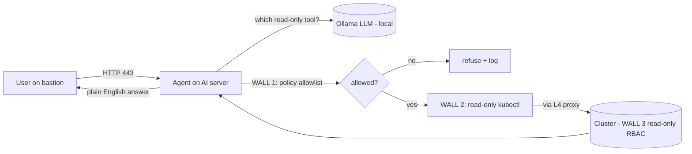

# Start Here

New to this project? **Read this file first**, then follow the guides in order.
Each guide is short. Every command has a one-line "what it does".

## Read in this order
1. **[01-prerequisites.md](01-prerequisites.md)** — the machines and tools you need first.
2. **[02-setup.md](02-setup.md)** — zero to a running agent, step by step.
3. **[03-config.md](03-config.md)** — every setting and what it does.
4. **[04-testing.md](04-testing.md)** — prove it works (and is safe).
5. **[05-operations.md](05-operations.md)** — deploy updates, logs, common fixes.
6. **[06-security.md](06-security.md)** — the safety model, in short.

For the full "how it works" deep dive, see **[../ARCHITECTURE.md](../ARCHITECTURE.md)**.

## What this is, in 20 seconds
An **offline** assistant for Kubernetes. You ask in plain English; a **local** AI
picks a **read-only** command; the code runs it and explains the result. It can
**never change anything**. Nothing leaves your network.

## The flow

Three independent walls (policy → executor → RBAC). All must fail for a write to
happen — and no write tool exists at all.

## The two ways to ask
- **`/query`** — quick facts ("how many pods"). Fast.
- **`/investigate`** — "why is X broken?". A multi-step loop that explains. Slower.

The `ask` client picks the right one for you automatically.
