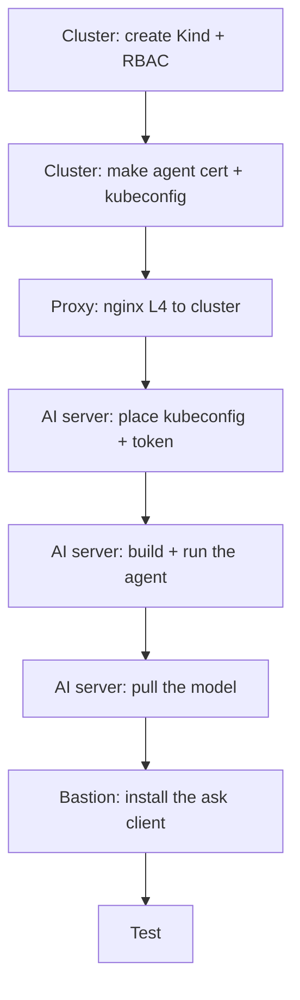

# 2. Setup — zero to running

Follow top to bottom. Do each block on the machine named in its heading.



---

## Step 1 — Cluster VM: create the cluster
```bash
kind create cluster --config k8s/kind-config.yaml   # builds a 3-node Kubernetes
kubectl get nodes                                    # all nodes should be Ready
```
> **In plain words:** this builds the Kubernetes cluster the agent will read from.
> **Why it matters:** no cluster, nothing to ask about.

## Step 2 — Cluster VM: apply read-only permissions (WALL 3)
```bash
kubectl apply -f k8s/rbac/                           # grants the agent read-only access only
kubectl auth can-i get secrets --as=ai-agent         # must print: no
```
> **In plain words:** this tells the cluster "the agent may only READ, and never
> secrets." **Why it matters:** this is the final safety wall — even if everything
> else failed, the cluster itself still blocks any write or secret access.

## Step 3 — Cluster VM: create the agent's login (mTLS client cert)
```bash
openssl ecparam -name prime256v1 -genkey -noout -out ai-agent.key   # the agent's private key
openssl req -new -key ai-agent.key -subj "/CN=ai-agent/O=aiops" -out ai-agent.csr  # a cert request
# submit ai-agent.csr as a Kubernetes CSR, approve it, extract ai-agent.crt
kubectl certificate approve ai-agent                 # Kubernetes signs the agent's cert
```
Then build `agent-kubeconfig.yaml` pointing at the **proxy** (`server:
https://192.168.255.135:6443`, `tls-server-name: 192.168.255.134`) with the CA +
the cert/key. (See [../ARCHITECTURE.md](../ARCHITECTURE.md) §4 for why the proxy.)
> **In plain words:** this makes the agent's "ID card" — a certificate that proves
> it is the read-only user `ai-agent`. **Why it matters:** no password is stored;
> the agent logs in with this cert, and any other/invalid login is rejected.

## Step 4 — Proxy VM: forward the Kubernetes API
```bash
sudo cp infra/nginx/stream.d/kube-api.conf /etc/nginx/stream.d/   # L4 passthrough config
sudo nginx -t && sudo systemctl reload nginx                      # test + apply
ss -tlpn | grep 6443                                              # should be listening
```
> **In plain words:** the proxy is a gatekeeper between the agent and the cluster.
> **Why it matters:** the agent never touches the cluster directly — one controlled
> door, and the cluster's IP stays hidden. (It passes traffic through untouched so
> the secure login still works.)

## Step 5 — AI server: place the kubeconfig and the token
```bash
sudo install -m 600 agent-kubeconfig.yaml /etc/ai-agent/kubeconfig   # the agent's cluster login
sudo chown 1000:1000 /etc/ai-agent/kubeconfig                        # container user must read it
cp .env.example .env                                                 # start from the template
# edit .env: set AGENT_TOKEN to the token you generated
```
> **In plain words:** you put the agent's cluster login on the AI server and set its
> password (the token). **Why it matters:** the kubeconfig is a secret — it stays
> only here, owned by the container user, never in git.

## Step 6 — AI server: build and run
```bash
export $(grep -v '^#' .env | xargs)      # load .env into this shell
docker compose up -d --build             # builds the agent, starts agent + Ollama
docker compose ps                        # both Up; agent (healthy)
```
> **In plain words:** this builds and starts the agent and the local AI (Ollama).
> **Why it matters:** `--build` bakes your latest code in; without it, old code keeps
> running.

## Step 7 — AI server: get the model (one-time, needs internet briefly)
```bash
docker network connect bridge ollama                               # temporarily give internet
docker exec ollama ollama pull qwen2.5:7b-instruct-q5_K_M          # download the local model
docker exec ollama ollama run qwen2.5:7b-instruct-q5_K_M "ok"      # warm it into memory
docker network disconnect bridge ollama                            # CUT internet (restore air-gap)
```
> **In plain words:** download the AI model once, then pull the internet plug.
> **Why it matters:** after this the AI runs fully offline — cluster data never
> leaves your network (the whole point of air-gapped).

## Step 8 — Bastion: install the `ask` client
```bash
sudo install -D -m 0755 client/ask.py /opt/ai-agent/ask.py         # the plain-text front end
mkdir -p ~/.config/ai-agent && chmod 700 ~/.config/ai-agent
( umask 077; printf '%s' "<YOUR_AGENT_TOKEN>" > ~/.config/ai-agent/token )  # token in a 600 file
sudo ln -sf /opt/ai-agent/ask.py /usr/local/bin/ask                # makes 'ask' a command
```
> **In plain words:** install the simple `ask` tool so users just type questions.
> **Why it matters:** the token sits in a locked 600 file (not typed each time), and
> users get plain-text answers — no curl, no JSON.

## Step 9 — Test
```bash
ask
ask> how many pods are running
ask> why is the web pod restarting in prd
```
Full test list: [04-testing.md](04-testing.md).
