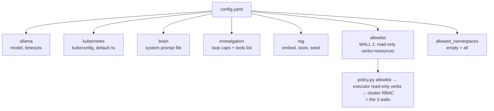

# 3. Configuration

All settings live in **`config.yaml`** (agent) and **`.env`** (secrets/host). Change
a value, then redeploy: `docker compose up -d --build`.

## The shape of `config.yaml` (top-level blocks)

The `allowlist` block feeds **WALL 1** (policy). Nothing the model suggests runs
unless it matches an entry here — and every entry is read-only.

## `config.yaml` — the knobs that matter

| Setting | What it does | Default |
|---------|--------------|---------|
| `ollama.model` | which local model to use | `qwen2.5:7b-instruct-q5_K_M` |
| `ollama.timeout_seconds` | max time for one model call | 300 |
| `ollama.query_timeout_seconds` | max time for a `/query` call | 90 |
| `kubernetes.kubeconfig` | path to the agent's cluster login (read-only) | `/app/kubeconfig` |
| `kubernetes.default_namespace` | namespace used when none is given | `default` |
| `allowlist` | the read-only verbs+resources `/query` may run | (list) |
| `allowed_namespaces` | restrict to these namespaces (empty = all) | `[]` |
| `investigation.max_steps` | max tool calls per investigation | 3 |
| `investigation.max_output_bytes` | truncate each tool's output | 3000 |
| `investigation.loop_timeout_seconds` | total time budget for the loop | 600 |
| `investigation.synth_reserve_seconds` | time kept for the final answer | 240 |
| `investigation.max_concurrent` | simultaneous investigations allowed (1 on a CPU box: two 7B calls at once saturate Ollama) | 1 |
| `investigation.cache_ttl_seconds` | cache identical questions this long (0=off) | 30 |
| `investigation.tools` | the read-only tools the loop may call | (list) |

## `.env` — host and secrets (never commit this)

| Variable | What it does |
|----------|--------------|
| `AGENT_TOKEN` | the shared secret the bastion sends and the agent checks |
| `AGENT_BIND_IP` | host IP the agent is published on (default 192.168.255.30) |
| `AGENT_KUBECONFIG` | host path to the read-only kubeconfig |
| `OLLAMA_MODEL` | model name (keep equal to `config.yaml` `ollama.model`) |
| `GIT_SHA` | optional build tag for traceability |

## Client (`ask`) settings — environment, optional

| Variable | What it does | Default |
|----------|--------------|---------|
| `AGENT_URL` | agent address | `http://192.168.255.30:443` |
| `AGENT_TOKEN_FILE` | where the token is read from | `~/.config/ai-agent/token` |
| `AGENT_CLIENT_TIMEOUT` | how long the client waits (must exceed the loop budget) | 660 |

## `config.yaml` — RAG memory (`rag:`, on by default; needs the embed model pulled)

| Setting | What it does | Default |
|---------|--------------|---------|
| `enabled` | turn RAG memory on/off | true |
| `embed_model` | local embedding model | nomic-embed-text |
| `embed_dim` | vector width — must match the embed model | 768 |
| `embed_timeout_seconds` | max time for one embed call | 20 |
| `top_k` | how many past cases to consider | 3 |
| `min_similarity` | ignore matches below this (0–1) | 0.75 |
| `max_rows` | cap the memory size | 5000 |
| `db_path` | the memory file (in a volume) | /app/memory/rag.db |
| `seed` | `{q, tools}` examples pre-loaded once into an empty DB (tools must be allowlisted) | ~12 examples |

Full guide: [10-rag.md](10-rag.md).

## Golden rule
Never add a tool or verb that can **change** the cluster. The allowlist and tools
are read-only on purpose. See [06-security.md](06-security.md).
