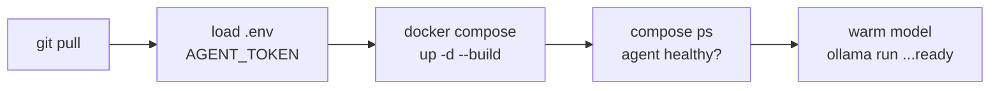

# 5. Operations

Day-to-day tasks. Run on the AI server unless noted.

## Deploy flow at a glance



`--build` rebuilds the **agent** image (Ollama is untouched). Warming after avoids a
slow first answer; the boot service below does it automatically.

## Deploy an update
```bash
cd ~/AiAgents-Kubernetes-AIOps && git pull   # get the latest code
export $(grep -v '^#' .env | xargs)          # load env
docker compose up -d --build                 # rebuild + restart the agent (Ollama untouched)
docker compose ps                            # confirm agent (healthy)
```

## Warm the model (avoids a slow first answer)
```bash
docker exec ollama ollama run qwen2.5:7b-instruct-q5_K_M "Reply in English: ready"
```

### Warm automatically on boot (optional)
So the first question after a reboot isn't slow, install the oneshot unit at
`infra/systemd/warm-models.service` (it runs the warm command for the chat and
embed models once Docker is up):
```bash
sudo cp infra/systemd/warm-models.service /etc/systemd/system/
sudo systemctl daemon-reload && sudo systemctl enable --now warm-models.service
```
Combined with `OLLAMA_KEEP_ALIVE=30m` (already set in compose), the model then
stays resident between requests.

## Watch what it's doing (live)
```bash
docker compose logs -f agent | grep -E "loop\.|investigate|denied"   # live events
docker exec ollama ollama ps                                         # is the model loaded?
```

## Read the audit trail
```bash
docker compose logs agent | grep '"event"'   # every question + action, as JSON
```

## Add a new read-only tool (3 places, keep in sync)
1. `app/tools.py` — add to `CATALOG` + `build_argv` (read-only verb only).
2. `config.yaml` — add its name to `investigation.tools`.
3. `k8s/rbac/clusterrole.yaml` — ensure the resource is allowed (get/list/watch).
Then `pytest` and redeploy. **Never add a write/change tool.**

## Rotate the token
```bash
openssl rand -hex 32                  # new token
# update .env on the AI server AND ~/.config/ai-agent/token on each bastion user
docker compose up -d                  # restart agent with the new token
```

## Common problems

| Symptom | Cause | Fix |
|---------|-------|-----|
| `invalid token` / 403 | token mismatch | same value in `.env` and the bastion's token file |
| 422 | empty/too-long question | shorten it |
| client "took too long" | CPU model slow / cold | warm the model; raise `AGENT_CLIENT_TIMEOUT` |
| `plan_error: timed out` in logs | one model call too slow on CPU | warm model; fewer steps; it still answers |
| `pull ... server misbehaving` | air-gap (no internet) | `docker network connect bridge ollama`, pull, then disconnect |
| answer in another language | model drift | brain prompt forces English; redeploy latest |
| kubeconfig "permission denied" | wrong owner | `chown 1000:1000` the kubeconfig, mode 600 |
