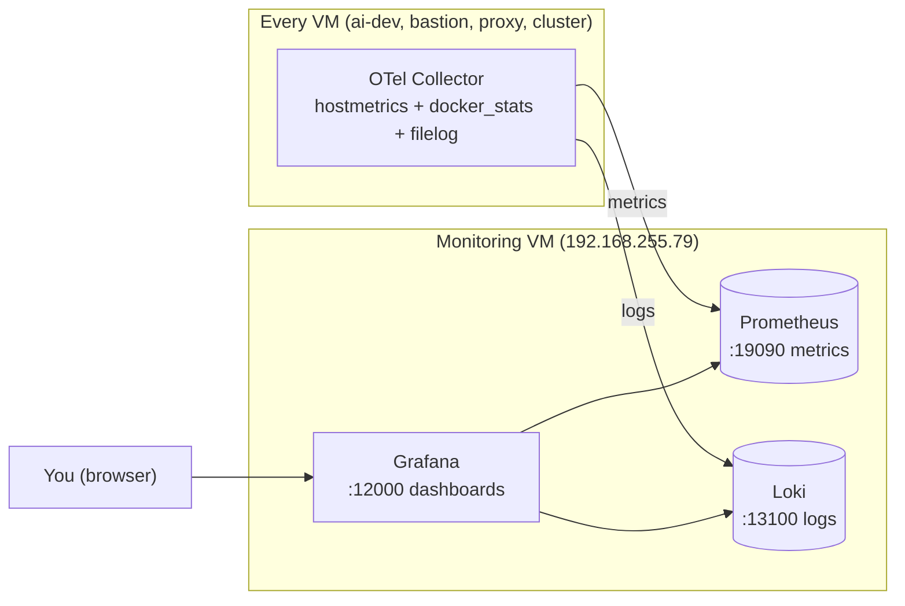

# 7. Monitoring & Observability

Free, offline, fintech-grade monitoring for all VMs: **metrics + logs** collected by
a lightweight agent on each VM, stored centrally, and viewed in Grafana.



**The rule:** detection + viewing live here; the stack **never** reaches the internet
(air-gapped). The AI agent stays separate and read-only.

---

## Components

| Where | What | Port (host) |
|-------|------|-------------|
| Monitoring VM | Prometheus (metrics store) | 19090 |
| Monitoring VM | Loki (logs store) | 13100 |
| Monitoring VM | Grafana (dashboards) | 12000 |
| Every VM | OpenTelemetry Collector (`otelcol-contrib`) | — (pushes out) |

Versions (verified, digest-pinned): Prometheus `v3.15.1`, Loki `3.7.9`,
Grafana `13.3.0`, OTel Collector `0.164.0`.

---

## Part A — Monitoring VM (Prometheus + Loki + Grafana)

Needs Docker. **Size the VM: ≥40 GB disk, ≥6 GB RAM, 2 CPU** (data grows — an
undersized disk crashes Loki).

### A1. Files (in `~/monitor/`)
`prometheus.yml`:
```yaml
global:
  scrape_interval: 15s
```
`.env` (chmod 600, never commit):
```
GRAFANA_ADMIN_PASSWORD=<strong-password>
```

### A2. `docker-compose.yml` (hardened, digest-pinned, bound to the LAN IP)
Key hardening already applied: non-root users, `cap_drop: ALL`,
`no-new-privileges`, read-only rootfs, resource limits, log rotation, ports bound
to the VM IP (not `0.0.0.0`). See the file in the repo at `infra/monitoring/` (or
the runbook) for the full content.

### A3. Bring it up
```bash
cd ~/monitor
docker compose pull          # pulls the pinned images (internet needed once)
docker compose up -d
docker ps                    # 3 containers Up, ports show 192.168.255.79:...
```

### A4. Verify (use the VM IP, not localhost — ports are bound to the IP)
```bash
curl -s http://192.168.255.79:19090/-/healthy   # Prometheus -> Healthy
curl -s http://192.168.255.79:13100/ready        # Loki -> ready
# Grafana UI: http://192.168.255.79:12000  (admin / your password)
```

### A5. Make it survive reboots
```bash
sudo systemctl enable docker     # containers auto-start on boot (restart: unless-stopped)
```

---

## Part B — OTel Collector on EVERY VM

Install the collector `.deb`, point it at the monitoring VM, run as a non-root user
with least-privilege log access.

### B1. Install (verified + checksum)
```bash
VER=0.164.0
BASE="https://github.com/open-telemetry/opentelemetry-collector-releases/releases/download/v${VER}"
curl -fsSL -o otelcol.deb        "${BASE}/otelcol-contrib_${VER}_linux_amd64.deb"
curl -fsSL -o otelcol.deb.sha256 "${BASE}/otelcol-contrib_${VER}_linux_amd64.deb.sha256"
test "$(sha256sum otelcol.deb | awk '{print $1}')" = "$(awk '{print $1}' otelcol.deb.sha256)" \
  && echo "CHECKSUM OK" || echo "CHECKSUM FAILED - STOP"
sudo dpkg -i otelcol.deb        # install (only after CHECKSUM OK)
```

### B2. Name the monitoring VM (so configs use a name, not a raw IP)
```bash
echo "192.168.255.79  monitoring.internal" | sudo tee -a /etc/hosts
```

### B3. Config — `/etc/otelcol-contrib/config.yaml`
```bash
sudo cp /etc/otelcol-contrib/config.yaml /etc/otelcol-contrib/config.yaml.bak.$(date +%F-%H%M)
sudo tee /etc/otelcol-contrib/config.yaml > /dev/null <<'EOF'
receivers:
  hostmetrics:
    collection_interval: 15s
    scrapers: { cpu: {}, memory: {}, disk: {}, filesystem: {}, load: {}, network: {}, paging: {} }
  docker_stats:                       # ONLY on VMs that run Docker (ai-dev, cluster, monitoring)
    endpoint: "unix:///var/run/docker.sock"
    collection_interval: 15s
    metrics:
      container.cpu.utilization: { enabled: true }
      container.memory.usage.total: { enabled: true }
  filelog:
    include: [ /var/log/syslog, /var/lib/docker/containers/*/*-json.log ]
    start_at: end
processors:
  resourcedetection: { detectors: [system] }
  batch: {}
exporters:
  prometheusremotewrite:
    endpoint: "http://monitoring.internal:19090/api/v1/write"
    resource_to_telemetry_conversion:
      enabled: true                   # <-- CRITICAL: adds host_name label to every metric
  otlphttp/loki:
    endpoint: "http://monitoring.internal:13100/otlp"
service:
  pipelines:
    metrics: { receivers: [hostmetrics, docker_stats], processors: [resourcedetection, batch], exporters: [prometheusremotewrite] }
    logs:    { receivers: [filelog],                   processors: [resourcedetection, batch], exporters: [otlphttp/loki] }
EOF
```
> On VMs with **no Docker** (bastion, proxy): remove the `docker_stats` receiver and
> drop it from the metrics pipeline. The `filelog` docker path simply matches nothing.

### B4. Least-privilege permissions + start
```bash
sudo usermod -aG adm otelcol-contrib                 # read /var/log/syslog (NOT root)
# Docker VMs only (to read container logs + docker.sock):
sudo setfacl -R -m u:otelcol-contrib:rX /var/lib/docker/containers
sudo usermod -aG docker otelcol-contrib              # docker_stats socket access (see note)

otelcol-contrib validate --config=/etc/otelcol-contrib/config.yaml && echo "CONFIG OK"
sudo systemctl enable --now otelcol-contrib
sudo systemctl restart otelcol-contrib
journalctl -u otelcol-contrib -n 20 --no-pager | grep -iE "error|denied"   # should be empty
```

### B5. Verify data lands (on the monitoring VM)
```bash
# every VM reporting (should list all of them):
curl -s 'http://192.168.255.79:19090/api/v1/query?query=system_memory_usage_bytes' | grep -o '"host_name":"[^"]*"' | sort -u
# container metrics (Docker VMs):
curl -s 'http://192.168.255.79:19090/api/v1/label/__name__/values' | tr ',' '\n' | grep -i container
# logs:
curl -s 'http://192.168.255.79:13100/loki/api/v1/labels'
```

---

## Grafana — data sources & dashboards

1. **Connections → Data sources → Add:**
   - Prometheus → URL `http://prometheus:9090` (internal name, inside the compose network)
   - Loki → URL `http://loki:3100`
2. **Build dashboards** (own them, keep in git — do NOT import random IDs from the internet).

### Dashboard design (best practice)
- **Fleet Overview** — all VMs at a glance (Stat + Bar gauges + trend graphs).
- **Host Detail** — one dashboard with a `host_name` dropdown (not one per VM).
- **Logs** — a Logs panel on the Loki data source.

### Ready panel queries (OTel metric names)
| Panel | Query | Viz / Unit |
|-------|-------|-----------|
| VMs reporting | `count(count by(host_name)(system_memory_usage_bytes))` | Stat / Number |
| CPU % by host | `100 * (1 - avg by(host_name)(rate(system_cpu_time_seconds_total{state="idle"}[$__rate_interval])))` | Time series / Percent |
| Memory % by host | `100 * sum by(host_name)(system_memory_usage_bytes{state="used"}) / sum by(host_name)(system_memory_usage_bytes)` | Bar gauge / Percent |
| Disk % by host | `100 * sum by(host_name)(system_filesystem_usage_bytes{state="used"}) / sum by(host_name)(system_filesystem_usage_bytes)` | Bar gauge / Percent |
| Network B/s | `sum by(host_name)(rate(system_network_io_bytes_total[$__rate_interval]))` | Time series / Bps |
| Containers running | `count(count by(container_name)(container_cpu_utilization_ratio))` | Stat / Number |
| Container CPU % | `container_cpu_utilization_ratio * 100` | Bar gauge / Percent (legend `{{container_name}}`) |
| Container RAM | `container_memory_usage_total_bytes` | Bar gauge / bytes (IEC) |
| Logs | `{service_name=~".+"}` (switch data source to **loki**) | Logs |

Use `$__rate_interval` for every `rate()` — never a hardcoded `[5m]`.

---

## Alerting (no extra container needed)

Use **Grafana built-in Alerting** (it ships its own Alertmanager). Add rules +
contact points. A webhook contact point → **n8n** is the bridge to automated action.

Starter rule — disk filling:
```
100 * sum by(host_name)(system_filesystem_usage_bytes{state="used"}) / sum by(host_name)(system_filesystem_usage_bytes) > 85
```

---

## Hardening checklist (fintech)

- [ ] Monitoring ports bound to the LAN IP (done) — not `0.0.0.0`.
- [ ] Restrict ports to the subnet — Docker **bypasses firewalld**, so use `DOCKER-USER`:
      `sudo iptables -I DOCKER-USER -p tcp -m multiport --dports 19090,13100,12000 ! -s 192.168.255.0/24 -j DROP`
- [ ] Grow the monitoring VM (≥40 GB disk) — a full disk crashes Loki.
- [ ] Strong Grafana password (in `.env`), sign-up disabled.
- [ ] Images **digest-pinned** (done) + scanned (`trivy image`).
- [ ] Collectors run **non-root**, `adm` group for logs (least privilege).
- [ ] Replace raw `docker.sock` access with a **read-only docker-socket-proxy** (later).
- [ ] Add **TLS** between collectors and the stack (later).

---

## Gotchas we hit (so you don't)

| Symptom | Cause | Fix |
|---------|-------|-----|
| No `host_name` label; all VMs merged | `prometheusremotewrite` drops resource attrs | add `resource_to_telemetry_conversion: enabled: true` |
| Collector still runs the demo "debug" config | restart didn't apply the new file | `validate` then `systemctl restart`; check logs show your receivers |
| `permission denied /var/log/syslog` | collector is non-root | `usermod -aG adm otelcol-contrib` |
| `container_*` metrics empty | `docker_stats` not added / no socket access | add receiver + `usermod -aG docker` |
| `localhost:19090` empty after binding to IP | port bound to LAN IP, not 127.0.0.1 | query via `192.168.255.79:19090` |
| firewalld "drop" but port still reachable | Docker bypasses firewalld | use `DOCKER-USER` iptables rules |
| Loki `connection refused` / crash | monitoring disk full | grow disk to ≥40 GB |
