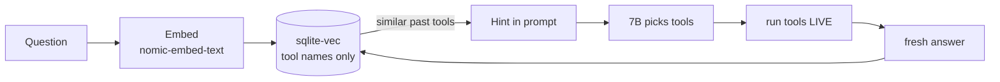

# 10. RAG memory (make the weak model more consistent)

The agent can remember **which read-only tools answered past questions** and reuse
that for similar new questions. It makes the small model more consistent — without
changing what it's allowed to do, and without ever returning stale data.



## How it works (simple)
1. A question is turned into a **vector** (numbers that capture meaning) by a local
   embed model.
2. The agent finds the **most similar past questions** and takes the **tool names**
   that worked for them.
3. Those names are added to the brain prompt as a **hint**.
4. The model picks tools → the loop **runs them live** → **today's real answer**.
5. On success, it **stores** this question + the tools that worked.

## Why it does NOT go stale
It stores the **method (tool names), never the values**. Every answer is computed
live from the cluster. "How many pods?" recalls *"use list_all_pods"* and runs it
now — it never returns an old count.

## RAG, the concept vs how THIS agent uses it

**Textbook RAG** (what most people mean) retrieves **document chunks** and feeds
them to the LLM as context:

```
1. User query        "What happens when CPU utilization increases?"
2. Embedding model   turn the question into a numeric vector
3. Vector database   find semantically similar vectors (similarity/distance)
4. Retrieved docs    "HPA adjusts pod replicas based on CPU utilization."
                     "Kubernetes autoscaling responds to resource demand."
5. LLM gets context  user question + retrieved docs + system instructions
6. Generated answer  "When CPU rises, the HorizontalPodAutoscaler can add pod
                      replicas if its scaling conditions are met."
```

In one line: *documents → embeddings → vector DB; the question → embedding;
retrieve the closest chunks by meaning; hand those chunks to the LLM, which writes
a natural-language answer from that context.*

**This agent's RAG is the same machinery, but it retrieves TOOL NAMES, not document
text** — a deliberate, security-driven choice (no data stored = nothing to leak, go
stale, or be injected). The retrieved names are a *hint for which read-only step to
run*, and the real answer still comes from running that tool live:

```
User:   Why is my application crashing?
RAG:    find relevant available TOOL NAMES (not documents)
Retrieved:
          get_pod_status
          get_pod_logs
          get_pod_events
LLM:    selects an appropriate read-only investigation step
Agent:  validates the selection (3 walls) and executes it LIVE
```

So: textbook RAG retrieves **knowledge to read**; this agent retrieves **tools to
run**. Same embed→vector-DB→retrieve→LLM flow, but what's stored and returned is
tool names, and the answer is always computed fresh from the cluster.

## Why it's safe (fintech)
- **Stores tool names only** — no cluster data, logs, or secrets. Nothing sensitive,
  nothing to leak.
- **No free-text re-injected** — only allowlisted tool names enter the prompt, so a
  poisoned memory **cannot prompt-inject**.
- **The three walls still gate every tool** — even a bad suggestion is blocked by
  policy → executor → RBAC. Memory can never escalate privilege.
- **Fail-open** — any error (embed down, DB missing) = the agent runs exactly as if
  RAG were off. It's an enhancement, never a dependency.
- **Similarity threshold** (weak matches ignored) + **size cap** + audited.

## Honest limits
- It improves **consistency + speed on repeat questions**, not raw intelligence. A
  7B stays a 7B.
- It ships **pre-seeded**: on first start (empty DB) the agent loads the `rag.seed`
  examples in `config.yaml`, so it helps from the very first question and keeps
  learning from real successful investigations after that.
- Costs ~0.3 GB RAM (embed model) + a tiny bit of latency per question.

## Setup
1. **Pull the embed model** (one-time, internet on) into the existing ollama volume:
   ```bash
   docker network connect bridge ollama
   docker exec ollama ollama pull nomic-embed-text
   docker network disconnect bridge ollama
   ```
2. **Enable it** in `config.yaml`:
   ```yaml
   rag:
     enabled: true
   ```
3. **Rebuild** the agent (adds `sqlite-vec` + the memory volume):
   ```bash
   docker compose up -d --build
   ```
4. Check it loaded (startup emits `rag.enabled` on success, `rag.disabled` on error):
   ```bash
   docker compose logs agent | grep -iE "rag.enabled|rag.disabled"
   # rag.enabled  -> on and healthy
   # rag.disabled -> failed to build (e.g. extension/db); runs as RAG-off
   # (nothing)    -> rag.enabled is false in config
   ```

## Config (`config.yaml` → `rag:`)
| Key | Meaning | Default |
|-----|---------|---------|
| `enabled` | turn RAG on/off | false |
| `embed_model` | local embedding model | nomic-embed-text |
| `embed_dim` | vector width — **must match the embed model** | 768 |
| `embed_timeout_seconds` | max time for one embed call (keeps the loop bounded) | 20 |
| `top_k` | how many past cases to consider | 3 |
| `min_similarity` | ignore matches below this (0–1) | 0.75 |
| `max_rows` | cap the memory size | 5000 |
| `db_path` | the memory file (in a volume) | /app/memory/rag.db |
| `seed` | list of `{q, tools}` examples loaded once into an empty DB | ~12 examples |

**Pre-seeding:** when the store is empty at startup the agent stores each `seed`
example (question → read-only tool names only) so RAG is useful from the first
query. Seeding emits `rag.seeded` (with row count), or `rag.seed_error` on failure
(fail-open — the agent still runs). Seed tools must be allowlisted; a test enforces
this (`tests/test_memory.py::test_seed_tools_are_all_allowlisted`).

## Files
- `app/memory.py` — the logic (recall/remember, allowlist-gated, fail-open).
- `app/memory_store.py` — the sqlite-vec store (one file on disk).
- `llm.py` `embed()` — turns text into a vector via Ollama.
- Wired into `agent_loop.py` (recall before, remember after a good answer).

## Turn it off
Set `rag.enabled: false` and redeploy. The agent behaves identically, minus the
memory hint. The DB file can be deleted safely.

---

# Deep dive (simple words, prod-grade)

## What RAG is, in one breath
**RAG = Retrieval-Augmented Generation.** Plain words: *before* the model answers,
you **look something up** and hand it that as a hint. "Augmented" = you gave the
model extra context it didn't have in its head. That's it. No retraining, no GPU,
no magic — just **search first, then generate**.

## What an embedding is (the core idea)
An **embedding** is a list of numbers (a **vector**) that captures the *meaning* of
a piece of text. A small neural model reads text and outputs, say, **768 numbers**.
The trick: **similar meaning → similar numbers.**

- "why is my pod crashing" and "what makes a container restart" land **close
  together** in number-space, even though they share almost no words.
- "how many pods" and "capital of France" land **far apart**.

So meaning becomes **geometry**: close vectors = related, far vectors = unrelated.
We measure closeness with **cosine distance** (angle between two vectors): 0 = same
direction (identical meaning), 1 = unrelated. `similarity = 1 − distance`.

Here the embed model is **`nomic-embed-text`** (runs in the same offline Ollama,
~274 MB, outputs **768 floats**). `embed_dim: 768` in config **must** match the
model's width or the math is meaningless — that's why it's a config value, not a guess.

## What a vector database is
A **vector DB** stores those vectors and answers one question fast:
> "Given this new vector, which stored vectors are **closest**?"

That's a **nearest-neighbour (KNN)** search. A naive version compares against every
row (fine for thousands); big systems use **ANN** (Approximate Nearest Neighbour)
indexes — HNSW, IVF, etc. — to stay fast at millions. Our store is small (capped at
`max_rows: 5000`), so an exact scan is already microseconds — no ANN needed.

## The vector-DB landscape (so you know the options)
There are two families. You do **not** need a server for a small, offline, read-only
memory like ours.

| Type | Examples | When to use |
|------|----------|-------------|
| **Embedded** (a library/file, no server) | **sqlite-vec** (what we use), FAISS, Chroma (local), LanceDB, DuckDB-VSS, usearch | Small/medium, single app, air-gapped, zero ops. **Our case.** |
| **Server / distributed** | Qdrant, Milvus, Weaviate, Postgres + **pgvector**, Elasticsearch/OpenSearch kNN, Redis-VSS, Pinecone (cloud) | Millions–billions of vectors, many clients, HA, filtering at scale. |

**Postgres users:** `pgvector` is the usual pick (vectors live next to your rows).
**Cloud/managed:** Pinecone. **Self-host at scale:** Qdrant or Milvus. **Tiny &
local:** sqlite-vec / FAISS. All do the *same* job (store vectors, find nearest);
they differ in **scale, ops cost, and where they run**.

## Why THIS agent uses sqlite-vec (prod-grade reasoning)
`sqlite-vec` is a loadable **SQLite extension** — it adds vector search to the
SQLite you already have. Our reasons map 1:1 to the project's hard rules:

- **Air-gapped / no server:** it's a **single file** (`/app/memory/rag.db`), no
  network port, no daemon, nothing to attack. A server DB would add a new listening
  service — the opposite of low blast radius.
- **Zero ops:** no cluster, no backups beyond copying one file (it's on the
  `agent_memory` Docker volume, so it persists across restarts/rebuilds).
- **Right-sized:** capped at 5000 rows → exact KNN is already instant; ANN indexes
  (HNSW/IVF) solve a scale problem we don't have.
- **Least dependency:** SQLite ships with Python; `sqlite-vec` is one small lib,
  loaded explicitly (`enable_load_extension` → `sqlite_vec.load`). Fail-open: if the
  extension can't load, RAG silently turns off and the agent runs normally.

## Exactly how our store works (low level)
Table is a **`vec0` virtual table** (that's the extension's engine). One row =
`(embedding float[768], question TEXT, tools TEXT)`.

```
remember(question, tools):
  vec = embed(question)                 # 768 floats, via nomic-embed-text
  bytes = struct.pack("768f", *vec)     # floats -> raw binary blob
  INSERT INTO memory(embedding, question, tools) VALUES (bytes, question, "list_all_pods,describe_pod")

recall(question):
  vec = embed(question)
  SELECT tools, distance FROM memory
    ORDER BY embedding <distance> vec    # cosine KNN, done in C inside sqlite-vec
    LIMIT top_k(3)
  keep rows where (1 - distance) >= min_similarity(0.75)
  drop any tool not on the allowlist     # poison-proofing
  -> ["list_all_pods","describe_pod"]    # a hint, never an answer
```

Because it's a **virtual table**, plain `sqlite3` can't read it until the extension
is loaded — that's why the inspect command in `docs/05`/this file loads `sqlite_vec`
first. The vectors are stored as packed **float32** blobs (`struct.pack`), the most
compact exact form.

## Prod-grade guarantees (what makes this safe to ship)
- **Stores tool NAMES only** — never cluster data, secrets, or values. Nothing to
  leak, nothing to go stale.
- **Allowlist-gated on the way out** — even a poisoned row can't introduce a
  non-allowlisted tool (`test_rag_recall_is_allowlist_gated`).
- **No free-text re-injection** — retrieved text is never fed back to the model, so
  there's **no prompt-injection surface** through memory.
- **Fail-open** — any embed/DB error → RAG off, agent unaffected.
- **Bounded** — `max_rows` caps growth; `min_similarity` ignores weak matches;
  `embed_timeout_seconds` stops a slow embed stalling the loop.
- **Persistent** — one file on a Docker volume; survives restart/reboot/rebuild.

## One-line mental model
Embedding = meaning-as-numbers. Vector DB = "find the closest numbers, fast." RAG =
look that up first, then let the model act. Here, what we look up is **which
read-only tool to run** — and the answer is always computed **live**.
