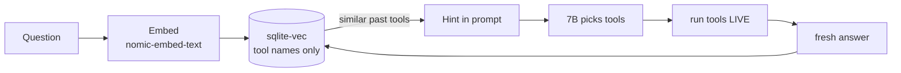

# 10. RAG memory (make the weak model more consistent)

The agent can remember **which read-only tools answered past questions** and reuse
that for similar new questions. It makes the small model more consistent — without
changing what it's allowed to do, and without ever returning stale data.



## How it works (simple)
1. A question is turned into a **vector** (numbers that capture meaning) by a local
   embed model.
2. The agent finds the **most similar past questions** and takes the **tool names**
   that worked for them.
3. Those names are added to the brain prompt as a **hint**.
4. The model picks tools → the loop **runs them live** → **today's real answer**.
5. On success, it **stores** this question + the tools that worked.

## Why it does NOT go stale
It stores the **method (tool names), never the values**. Every answer is computed
live from the cluster. "How many pods?" recalls *"use list_all_pods"* and runs it
now — it never returns an old count.

## Why it's safe (fintech)
- **Stores tool names only** — no cluster data, logs, or secrets. Nothing sensitive,
  nothing to leak.
- **No free-text re-injected** — only allowlisted tool names enter the prompt, so a
  poisoned memory **cannot prompt-inject**.
- **The three walls still gate every tool** — even a bad suggestion is blocked by
  policy → executor → RBAC. Memory can never escalate privilege.
- **Fail-open** — any error (embed down, DB missing) = the agent runs exactly as if
  RAG were off. It's an enhancement, never a dependency.
- **Similarity threshold** (weak matches ignored) + **size cap** + audited.

## Honest limits
- It improves **consistency + speed on repeat questions**, not raw intelligence. A
  7B stays a 7B.
- Useless until it has history — seed it with a few good questions, let it grow.
- Costs ~0.3 GB RAM (embed model) + a tiny bit of latency per question.

## Setup
1. **Pull the embed model** (one-time, internet on) into the existing ollama volume:
   ```bash
   docker network connect bridge ollama
   docker exec ollama ollama pull nomic-embed-text
   docker network disconnect bridge ollama
   ```
2. **Enable it** in `config.yaml`:
   ```yaml
   rag:
     enabled: true
   ```
3. **Rebuild** the agent (adds `sqlite-vec` + the memory volume):
   ```bash
   docker compose up -d --build
   ```
4. Check it loaded (startup emits `rag.enabled` on success, `rag.disabled` on error):
   ```bash
   docker compose logs agent | grep -iE "rag.enabled|rag.disabled"
   # rag.enabled  -> on and healthy
   # rag.disabled -> failed to build (e.g. extension/db); runs as RAG-off
   # (nothing)    -> rag.enabled is false in config
   ```

## Config (`config.yaml` → `rag:`)
| Key | Meaning | Default |
|-----|---------|---------|
| `enabled` | turn RAG on/off | false |
| `embed_model` | local embedding model | nomic-embed-text |
| `embed_dim` | vector width — **must match the embed model** | 768 |
| `embed_timeout_seconds` | max time for one embed call (keeps the loop bounded) | 20 |
| `top_k` | how many past cases to consider | 3 |
| `min_similarity` | ignore matches below this (0–1) | 0.75 |
| `max_rows` | cap the memory size | 5000 |
| `db_path` | the memory file (in a volume) | /app/memory/rag.db |

## Files
- `app/memory.py` — the logic (recall/remember, allowlist-gated, fail-open).
- `app/memory_store.py` — the sqlite-vec store (one file on disk).
- `llm.py` `embed()` — turns text into a vector via Ollama.
- Wired into `agent_loop.py` (recall before, remember after a good answer).

## Turn it off
Set `rag.enabled: false` and redeploy. The agent behaves identically, minus the
memory hint. The DB file can be deleted safely.
